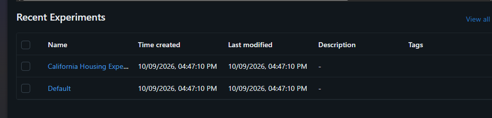
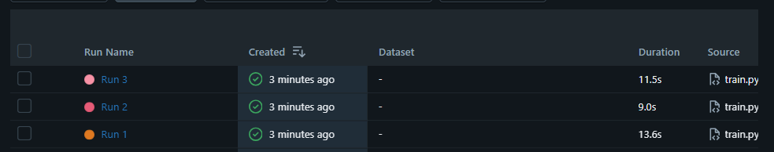
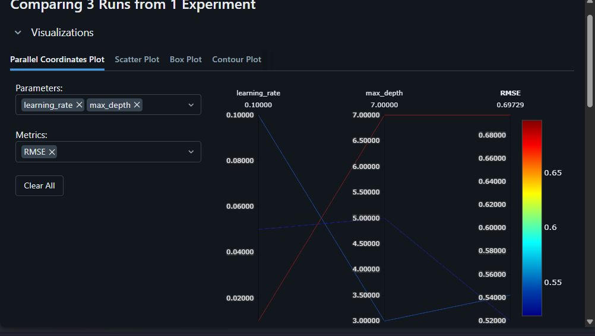
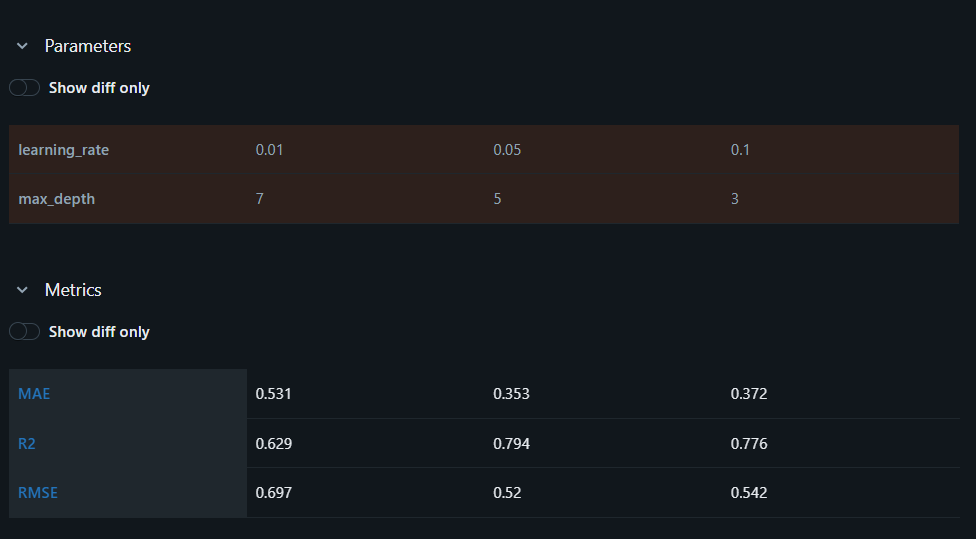
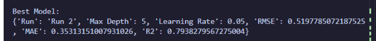

# California Housing Price Prediction with MLflow
 
## 1. Task Description
 
This project trains a regression model to predict house prices on the **California Housing** dataset and uses **MLflow** to track experiments.
 
Three runs were trained with different hyperparameter combinations (`max_depth` and `learning_rate`). For each run, MLflow logged the parameters and three evaluation metrics (**RMSE**, **MAE**, **R²**). The runs were then compared to select the best-performing model.

### Project Structure
    MLflow-task/
    ├── train.py
    ├── requirements.txt
    └── README.md
 
## 2. How to Run the Project
 
**1. Clone the repository**

```bash
git clone https://github.com/Bassant-27/MLflow-task.git
cd MLflow-task
```

**2. Create and activate a virtual environment**

Windows PowerShell:

```bash
python -m venv .venv
.\.venv\Scripts\Activate.ps1
```

**3. Install the dependencies**
 
```bash
pip install mlflow scikit-learn pandas numpy
```
 
**4. Run the training script**
 
```bash
python train.py
```
 
This trains the three models (Run 1, Run 2, Run 3), logs their parameters and metrics to MLflow, and prints the results and the best model in the terminal.
 
**5. Open the MLflow UI**
 
```bash
mlflow ui
```
 
Then open <http://127.0.0.1:5000> in your browser, select the California Housing experiment, and tick the three runs to compare them.

## 3. MLflow Experiment Results
 
**Experiments list**
 

 
**Runs in the experiment**
 

 
**Parallel coordinates plot (learning rate, max depth vs. RMSE)**
 

 
 ## 4. Comparison of the Three Runs
**Parameters and metrics comparison**
 


 

## 5. Selected Best Model
 
**Run 2**: 


 

## 6. Why Run 2 Was Selected
 
Run 2 is the best on every metric: it has the **lowest RMSE (0.5198)**, the **lowest MAE (0.3531)** and the **highest R² (0.7938)**, so it explains about 79% of the variance in house prices.
 
